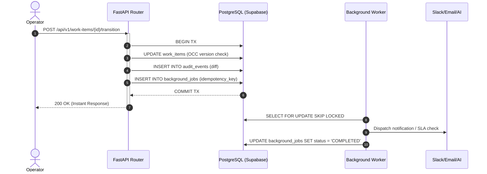

# Team-Up — Core Engineering Decisions & Architectural Trade-Offs

This document records the foundational architectural decisions, technical justifications, trade-offs, and alternatives considered during the design and development of **Team-Up**.

---

## 1. Data Modeling: Team-Scoped Multi-Role RBAC vs. Flat Global Roles

### Context & Problem
In an organization with 500+ employees, permissions are rarely monolithic. An employee can be a `LEAD` with approval authority in one department (e.g., Customer Support) while acting as a regular `MEMBER` or read-only `OBSERVER` when collaborating on an incident owned by another department (e.g., Engineering or Compliance).

### Decision
We implemented a **junction entity model** (`TeamMember`) linking `User` and `Team` with an explicit enum `team_role` (`LEAD`, `MEMBER`, `OBSERVER`), alongside a minimal `system_role` (`ADMIN`, `MEMBER`) on the `User` entity.

```sql
CREATE TABLE team_members (
    id VARCHAR(36) PRIMARY KEY,
    user_id VARCHAR(36) REFERENCES users(id) ON DELETE CASCADE,
    team_id VARCHAR(36) REFERENCES teams(id) ON DELETE CASCADE,
    team_role VARCHAR(20) NOT NULL,
    created_at TIMESTAMP WITH TIME ZONE DEFAULT NOW(),
    CONSTRAINT uq_user_team UNIQUE (user_id, team_id)
);
```

### Alternatives Considered
1. **Flat User Role (e.g., `role: "ENGINEERING_LEAD"`)**: Rejected because real enterprise employees belong to multiple squads simultaneously, and role sprawl rapidly explodes.
2. **Dynamic Permission Bits / Casbin Engine**: Considered flexible, but adds substantial latency and schema overhead without improving correctness for an operational coordination workflow.

### Trade-Offs & Mitigations
- **Trade-Off**: Every sensitive API mutation (claim, status transition, gated approval) requires joining the user's team memberships.
- **Mitigation**: Added a composite unique index `(user_id, team_id)` and eager-loaded memberships via SQLAlchemy `selectinload` to keep permission lookups in $O(1)$ memory after a single query.

---

## 2. Concurrency: Optimistic Concurrency Control (OCC) vs. Pessimistic Locking

### Context & Problem
Multiple operators frequently examine high-priority operational tickets simultaneously during incidents. If Operator A and Operator B both open a ticket and make conflicting modifications, standard "Last-Write-Wins" silently destroys Operator A's work.

### Decision
We selected **Optimistic Concurrency Control (OCC)** using a strictly incrementing `version` integer column on `work_items`, combined with an **Atomic Conditional Claim** for ownership assignment.

1. **General Ticket Edits (OCC)**:
   ```sql
   UPDATE work_items 
   SET title = :title, description = :description, version = version + 1, updated_at = NOW()
   WHERE id = :id AND version = :client_version;
   ```
   If the update returns zero affected rows, the backend immediately raises an `HTTP 409 Conflict` with a structured `ConflictDetail` payload containing the server's current version and updated attributes. The frontend catches this and displays a side-by-side visual conflict resolution dialog.

2. **Atomic Claiming (First-Write-Wins)**:
   ```sql
   UPDATE work_items 
   SET assignee_id = :user_id, version = version + 1, updated_at = NOW()
   WHERE id = :id AND assignee_id IS NULL;
   ```
   If two operators click "Take Ownership" in the exact same millisecond, the database serializes the atomic update. Exactly one transaction claims the ticket, and the second receives `HTTP 409 Conflict: Already claimed by [Operator]`.

### Alternatives Considered
- **Pessimistic Locking (`SELECT FOR UPDATE`)**: Kept tickets locked while an operator had the edit drawer open. Rejected because it locks database rows indefinitely if an operator disconnects, closes their laptop, or navigates away.
- **Distributed Locking via Redis / Redlock**: Adds external infrastructure dependency and network hop failure modes without adding correctness over native PostgreSQL row locking.

---

## 3. Synchronous vs. Asynchronous Work Boundaries

### Context & Problem
Operational actions have different latency and durability requirements:
- **Critical Path**: Ownership changes, status transitions, gated approvals, and audit trail records must commit immediately with ACID guarantees.
- **Side Effects**: Audit webhooks, cross-team email/Slack notifications, SLA calculation timers, and LLM triage analysis must never block or fail the primary user transaction.

### Decision
We split system operations into strict transactional boundaries:
1. **Synchronous Boundary (ACID)**:
   - Work item state transitions
   - OCC version checks
   - Immutable audit event insertion (`audit_events` with `old_values` and `new_values` JSON diffs)
   - Storing a durable `background_jobs` row inside the *same* database transaction.
2. **Asynchronous Boundary (Resilient Queue)**:
   - A persistent, idempotent worker pulls pending jobs from `background_jobs` using `FOR UPDATE SKIP LOCKED`.
   - Each job carries an `idempotency_key`, `max_retries` (default: 3), and exponential backoff tracking.
   - External notifications or AI triage run outside the HTTP request lifecycle.



---

## 4. Google OAuth 2.0 Architecture & Cryptographic Verification

### Context & Problem
Enterprise identity demands secure authentication without manual mock credentials or vendor lock-in. A production system must verify credentials cryptographically on the server.

### Decision
We integrated **Google Identity Services (GIS)** on the frontend and server-side verification via Google's OAuth 2.0 tokeninfo API:
1. The frontend invokes Google Identity Services (`accounts.google.com/gsi/client`) to render the official Google Sign-In widget.
2. Upon user authorization, Google returns a cryptographically signed JWT `id_token`.
3. The frontend submits the `id_token` to `POST /api/v1/auth/google`.
4. The FastAPI backend calls `https://oauth2.googleapis.com/tokeninfo?id_token=...` via `httpx` to verify Google's signature, expiry, and email verification status (`email_verified == True`).
5. If valid, the backend automatically provisions or logs in the employee in PostgreSQL and links them to their selected department.

### Benefits
- **Zero Credential Storage**: Eliminates risk of password breaches.
- **Cryptographic Trust**: Prevents request spoofing or email forgery.
- **Developer Flexibility**: Provides in-app Google Client ID configuration for custom Google Cloud projects and sandbox testing fallback.

---

## 5. Intentional Omissions & Pragmatic Simplifications

To prioritize correctness on high-risk concurrency and authorization invariants within the evaluation timeframe, the following scope decisions were intentionally made:

| Omission | Justification & Production Path |
| :--- | :--- |
| **Full WebSockets Engine** | Replaced with reactive client-side refetches and optimistic UI transitions. A production deployment would introduce server-sent events (SSE) or WebSockets via Supabase Realtime / Redis pub/sub. |
| **Complex Drag-and-Drop Kanban** | Prioritized high-density, server-paginated tabular triage queues with multi-dimensional filtering, which mirror enterprise operational tools (Linear, Jira Service Desk). |
| **Custom Password Reset & MFA** | Delegated identity to Google OAuth 2.0 and enterprise SSO rather than reimplementing bespoke cryptography. |
