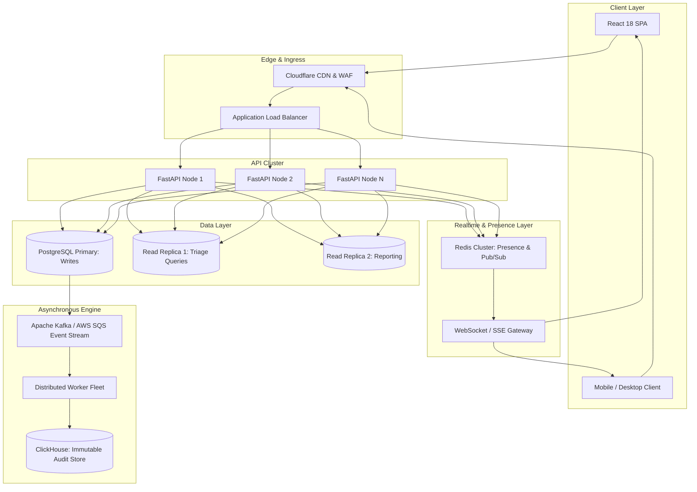

# Team-Up — Known Limitations & Enterprise Scaling Roadmap

This document outlines the current technical boundaries of **Team-Up**, potential failure modes under 10x–100x scaling pressures, and the concrete architecture roadmap to transition from a single-region deployment to a high-throughput enterprise platform.

---

## 1. Current System Limitations & Technical Debt

### 1.1 In-Process Queue Worker vs. Distributed Worker Fleet
- **Current State**: Asynchronous tasks are backed by the PostgreSQL `background_jobs` table and processed asynchronously via an in-process worker loop.
- **Limitation**: If the API server process restarts unexpectedly, in-flight jobs in memory may need to wait for their next poll interval. Background tasks share CPU and memory resources with API request handling.
- **Production Path**: Extract the background consumer into dedicated worker containers orchestrated via Celery, Temporal, or AWS SQS.

### 1.2 Reactive Polling vs. Full Real-Time Push (WebSockets / SSE)
- **Current State**: The frontend refreshes triage views upon user action and manual trigger.
- **Limitation**: While OCC prevents silent overwrites, operators must refresh or attempt a mutation to discover that another operator has modified or claimed a ticket.
- **Production Path**: Implement Server-Sent Events (SSE) or WebSockets using Supabase Realtime / Redis PubSub to broadcast ticket invalidation events in sub-second latency.

### 1.3 Monolithic Audit Event Storage
- **Current State**: `audit_events` rows are appended directly to the primary PostgreSQL database in the same transaction as the ticket mutation.
- **Limitation**: For a company processing 100,000 actions per day, the `audit_events` table grows at $10\times$ the rate of the `work_items` table, eventually causing table bloat and index maintenance overhead.
- **Production Path**: Apply PostgreSQL table partitioning (declarative range partitioning by month/quarter) or stream immutable audit logs to an append-only analytical store (e.g., ClickHouse or AWS S3 via Firehose).

---

## 2. Failure Modes Under Extreme Load (10x–100x Scale)

| Component | 10x Load (5,000 Users) | 100x Load (50,000+ Users) | Failure Mode & Remediation |
| :--- | :--- | :--- | :--- |
| **PostgreSQL Connection Pool** | ~150 concurrent connections. Handled easily by Supabase Session Pooler. | ~2,500 concurrent connections. Direct connections would exhaust server memory. | **Failure**: `too many clients already` errors. **Remediation**: Dedicated PgBouncer pooler layer with aggressive transaction-level pooling and read replica offloading. |
| **OCC Collision Frequency** | Minor contention on P0 incidents (~2-3% collision rate). | High contention during company-wide outages (~20-30% collision rate on central incident tickets). | **Failure**: Operator frustration due to repeated 409 Conflict retries. **Remediation**: Collaborative real-time presence (showing *"Alex Rivera is currently editing this ticket"*) and field-level granular merge rather than record-level OCC. |
| **Audit Log Querying** | Sub-15ms queries with current B-Tree indexing. | Query latency degradation when timeline spans hundreds of thousands of events. | **Failure**: Slow ticket drawer loading. **Remediation**: Cursor-based pagination on `audit_events` and cold-storage archiving for resolved items older than 90 days. |
| **AI Copilot (Gemini API)** | Within standard rate limits. | Rate limiting (HTTP 429) during batch triage spikes. | **Failure**: Blocked or slow ticket creation if AI triage was synchronous. **Remediation**: AI triage is already asynchronous; add a fallback heuristic classifier (keyword/regex) when LLM quota is saturated. |

---

## 3. Concrete 10x–100x Scaling Evolution Roadmap

### Phase 1 (10x: 5,000 Employees) — Read Replicas & Live Presence
1. **Read-Write Splitting**: Route all search, filter, and triage list queries to PostgreSQL read replicas. Direct only mutations (claims, transitions, approvals) to the primary node.
2. **Collaborative Presence**: Introduce a lightweight Redis cluster to broadcast active viewer heartbeats (`"Jordan is viewing this ticket"`), reducing OCC collisions before they happen.
3. **Supabase Realtime**: Connect client instances to Supabase Realtime channels to auto-refresh ticket status cards without full-page reloads.

### Phase 2 (50x: 25,000 Employees) — Distributed Queues & Partitioning
1. **Event Bus Decoupling**: Transition from database-backed `background_jobs` to a dedicated message broker (Apache Kafka or AWS SQS) for notifications, SLA monitors, and webhooks.
2. **PostgreSQL Declarative Partitioning**: Partition `audit_events` and `comments` by month to maintain rapid query execution and index efficiency regardless of history size.
3. **Elasticsearch / OpenSearch Projection**: Implement CQRS (Command Query Responsibility Segregation) to power complex multi-faceted text searches across hundreds of thousands of work items.

### Phase 3 (100x: 50,000+ Employees) — Global High Availability & Multi-Region
1. **Multi-Region Read Caching**: Deploy API nodes across US, EU, and APAC with local read replicas and distributed edge caching for organization rosters and team structures.
2. **Field-Level CRDT Merging**: Evolve from record-level OCC to Conflict-Free Replicated Data Types (CRDTs) or field-level versioning for simultaneous multi-operator collaboration.
3. **Long-Term Cold Audit Storage**: Automatically move audit records older than 180 days to compressed Parquet files in object storage, queried via AWS Athena or ClickHouse.
