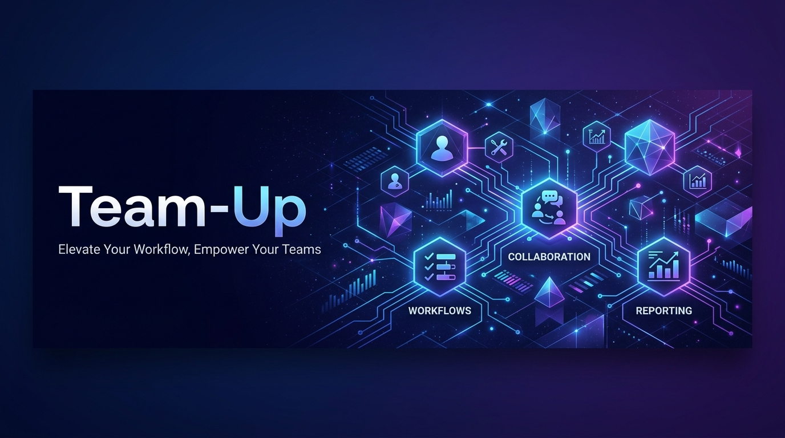
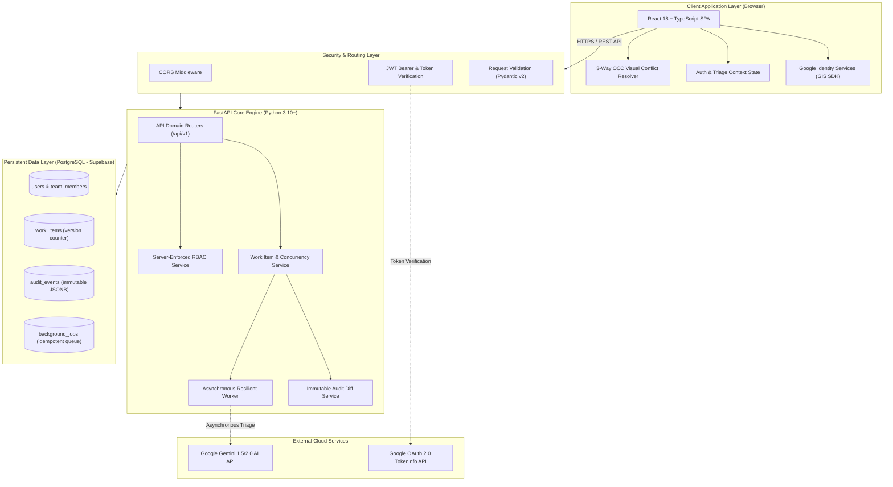
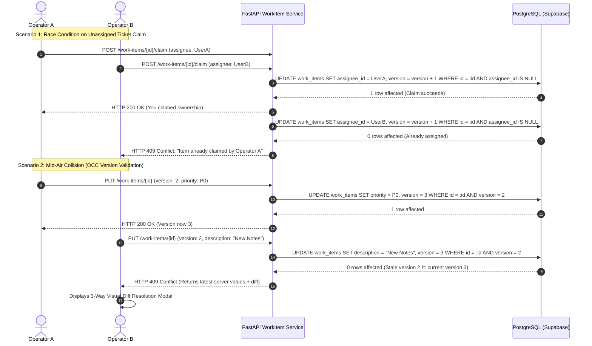
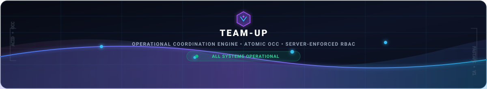

<p align="center">
  
</p>

# Team-Up — Operational Work Coordination Engine

<p align="center">
  <a href="#system-architecture"></a>
  <a href="#technology-stack"></a>
  <a href="#technology-stack"></a>
  <a href="#technology-stack"></a>
  <a href="#technology-stack"></a>
  <a href="#technology-stack"></a>
  <a href="#automated-testing"></a>
  <a href="#google-oauth-20-configuration"></a>
</p>

---

> **Team-Up** is a high-concurrency operational coordination platform engineered for scaling enterprises (500+ employees). It replaces informal chat messages, chaotic spreadsheets, and lost email threads with server-enforced correctness: **Atomic Responsibility Claiming**, **Optimistic Concurrency Control (OCC)**, **Department-Scoped Role-Based Access Control (RBAC)**, **Gated Approvals**, and an **Immutable Audit Event Ledger**.

---

## 📑 Table of Contents
1. [Core Distributed Problems Solved](#1-core-distributed-problems-solved-beyond-crud)
2. [System Architecture & Data Flow](#2-system-architecture--data-flow)
3. [Interactive Operational Workflow](#3-interactive-operational-workflow)
4. [Technology Stack](#4-technology-stack)
5. [Repository Structure](#5-repository-structure)
6. [Quickstart & Installation](#6-quickstart--installation)
7. [Google OAuth 2.0 & Identity Management](#7-google-oauth-20--identity-management)
8. [Seed Employee Roster & Role Matrix](#8-seed-employee-roster--role-matrix)
9. [Automated Risk-Based Testing](#9-automated-risk-based-testing)
10. [REST API Reference](#10-rest-api-reference)
11. [Design System & Frontend Aesthetics](#11-design-system--frontend-aesthetics)
12. [License & Governance](#12-license--governance)

---

## 1. Core Distributed Problems Solved ("Beyond CRUD")

Operational environments—incident triage, fraud payment investigations, customer escalations, and regulatory GDPR requests—suffer severe monetary and legal penalties when updates collide or state invariants break. Team-Up eliminates these failure modes at the architecture level:

| Distributed Challenge | Failure Mode in Standard Apps | How Team-Up Solves It | Result / HTTP Code |
| :--- | :--- | :--- | :--- |
| **Atomic Claiming** | Two workers simultaneously click *"Take Ownership"* on an urgent P0 incident; both believe they own it, creating duplicate effort or conflicting resolutions. | Atomic conditional SQL update:<br>`UPDATE work_items SET assignee_id = :uid, version = version + 1 WHERE id = :id AND assignee_id IS NULL`.<br>Database serializes concurrent transactions; exactly one succeeds. | `200 OK` (Claimant)<br>`409 Conflict` (Loser) |
| **Optimistic Concurrency Control (OCC)** | Operator A opens a ticket; Operator B updates it while A was typing. Operator A saves and silently destroys Operator B's changes ("Last-Write-Wins"). | Strict integer `version` counter enforced on mutation:<br>`WHERE id = :id AND version = :client_version`.<br>Rejects stale updates and returns the server's current state with a 3-way visual diff dialog. | `409 Conflict`<br>(Structured Diff) |
| **Server-Enforced RBAC & Approvals** | Rogue clients or frontend inspections allow unauthorized employees to approve sensitive refunds, change teams, or close incidents. | Department-scoped role tiers (`LEAD`, `MEMBER`, `OBSERVER`) enforced strictly on the API layer. High-risk actions require explicit sign-off from an assigned team's `LEAD`. | `403 Forbidden` |
| **State Machine Invariants** | An incident skips required triage steps or is illegally resolved directly from `NEW`. | Hardcoded deterministic state machine graph (`NEW` &rarr; `TRIAGED` &rarr; `IN_PROGRESS` &rarr; `PENDING_APPROVAL` &rarr; `RESOLVED`). | `422 Unprocessable Entity` |
| **Immutable Audit Trail** | Compliance auditors cannot prove who authorized a payout, what values were altered, or when the decision occurred. | Append-only `audit_events` table recording actor, action timestamp, and granular previous vs new JSONB diffs. Rows are permanent and tamper-evident. | Stored Forever |
| **Google OAuth 2.0 Security** | Insecure login or unverified email spoofing. | Google Identity Services (GIS SDK) + server-side JWT verification against Google Tokeninfo API, auto-provisioning verified users in Supabase PostgreSQL. | `200 OK` / `401 Unauthorized` |

---

## 2. System Architecture & Data Flow

### End-to-End Component Architecture



---

### Sequence Diagram: Concurrency Claim & OCC Conflict Resolution



---

## 3. Interactive Operational Workflow

The lifecycle of an operational work item guarantees compliance and zero silent updates:

```
[1. INTAKE & SMART TRIAGE]
       │  • User submits operational ticket via "+ New Request" modal
       │  • Gemini AI automatically infers priority (P0–P3) and category
       ▼
[2. ATOMIC CLAIMING]
       │  • Frontline triage operator clicks "Take Ownership"
       │  • Atomic conditional SQL locks item; competitors safely rejected
       ▼
[3. INVESTIGATION & EDITING (OCC)]
       │  • Operator modifies status, updates notes, or escalates priority
       │  • Integer version checks prevent mid-air collision overwrites
       ▼
[4. GATED LEAD AUTHORIZATION]
       │  • High-risk tickets (Fraud Wire, GDPR Deletions) require sign-off
       │  • Server RBAC verifies operator has 'LEAD' role in owning department
       ▼
[5. RESOLUTION & IMMUTABLE AUDIT]
          • Work item reaches 'RESOLVED' state
          • Full cryptographic history preserved with actor-attributed diffs
```

---

## 4. Technology Stack

| Layer | Technology | Version | Purpose & Architectural Justification |
| :--- | :--- | :--- | :--- |
| **Backend Framework** | **FastAPI** | `^0.110.0` | High-performance asynchronous execution, strict typing with Pydantic v2, dependency injection for server-side authorization, and auto-generated OpenAPI/Swagger specifications. |
| **Database** | **PostgreSQL** (Supabase) | `15.x` | True ACID compliance, row-level locking (`SELECT FOR UPDATE`), atomic conditional updates (`UPDATE ... WHERE`), and native `JSONB` for immutable audit history diffs. |
| **ORM & Driver** | **SQLAlchemy + asyncpg** | `^2.0.28` | Async connection pooling, declarative data contracts, and raw SQL transactional controls for high-concurrency operations. |
| **Frontend Framework** | **React + Vite** | `^18.2.0` | Declarative UI, rapid HMR development, and modular component architecture. |
| **Type Safety** | **TypeScript** | `^5.2.2` | Compile-time validation across all API request and response models. |
| **Design System** | **Custom Vanilla CSS** | Pure CSS | High-density operational interface (Linear/Stripe-inspired). Tokenized CSS variables for dual Light/Dark themes and zero heavy library overhead. |
| **Authentication** | **Google Identity Services (GIS)** | `v1` | Cryptographic OpenID Connect authentication + live server token verification. |
| **AI Copilot** | **Google Gemini API** | `1.5/2.0` | Automated priority recommendations, category detection, and root-cause summaries. |
| **Automated Testing** | **pytest + pytest-asyncio** | `^8.1.1` | Asynchronous test harness testing concurrent race conditions, OCC conflicts, and RBAC authorization invariants. |

---

## 5. Repository Structure

```
Newtonite_Asessment_Project/
├── assets/                               # Visual assets and documentation banners
│   ├── teamup_header_banner.jpg          # Header banner image
│   └── teamup_footer_banner.jpg          # Footer banner image
├── backend/                              # FastAPI Python Backend
│   ├── .env.example                      # Backend environment variable template
│   ├── requirements.txt                  # Python dependencies
│   ├── pytest.ini                        # Pytest configuration
│   ├── app/
│   │   ├── main.py                       # Application entry point, lifespan, & CORS
│   │   ├── config.py                     # App settings & environment loader
│   │   ├── database.py                   # Async SQLAlchemy engine & session factory
│   │   ├── models/                       # SQLAlchemy Database Models
│   │   │   ├── user.py                   # User entity & system roles
│   │   │   ├── team.py                   # Team & department memberships
│   │   │   ├── work_item.py              # Work items with OCC version counter
│   │   │   ├── audit.py                  # Append-only immutable audit trail (JSONB)
│   │   │   └── background_job.py         # Durable asynchronous job queue
│   │   ├── schemas/                      # Pydantic v2 Request/Response Schemas
│   │   ├── services/                     # Core Business Logic & Invariants
│   │   │   ├── work_item_service.py      # OCC, atomic claim, & state transitions
│   │   │   ├── authz_service.py          # Server-enforced RBAC & gated approvals
│   │   │   ├── audit_service.py          # Field-level diff computation
│   │   │   ├── ai_service.py             # Google Gemini AI triage copilot
│   │   │   └── async_queue_service.py    # Idempotent background worker
│   │   ├── routers/                      # REST Endpoints (/auth, /teams, /work-items, /audit)
│   │   ├── seed.py                       # Initial enterprise seed data
│   │   └── cleanup_demo_data.py          # Database sanitizer
│   └── tests/                            # Automated Risk-Based Test Suite
│       ├── conftest.py                   # Test client & async DB fixtures
│       ├── test_concurrency_claim.py     # Dual-claim race condition tests
│       ├── test_occ_conflicts.py         # OCC stale version collision tests
│       ├── test_authorization_rbac.py    # Server-enforced RBAC tests
│       ├── test_state_machine.py         # Workflow state machine invariant tests
│       └── test_google_auth.py           # Google OAuth cryptographic token tests
├── frontend/                             # React 18 + Vite Frontend
│   ├── .env.example                      # Frontend environment variable template
│   ├── package.json                      # Node dependencies & build scripts
│   ├── vite.config.ts                    # Vite bundler configuration & proxy
│   ├── tsconfig.json                     # TypeScript strict configuration
│   ├── public/
│   │   ├── favicon.ico                   # Application favicon
│   │   └── logo.png                      # App brand logo
│   └── src/
│       ├── main.tsx                      # Application DOM bootstrap
│       ├── App.tsx                       # Operational command center shell & routing
│       ├── index.css                     # High-density tokenized design system
│       ├── types/index.ts                # TypeScript data interfaces
│       ├── context/AuthContext.tsx       # Auth session & persona switching context
│       ├── services/api.ts               # Type-safe HTTP client
│       └── components/
│           ├── LandingPage.tsx           # Public landing page with navigation & footer
│           ├── AuthModal.tsx             # Google OAuth & persona switcher modal
│           ├── Sidebar.tsx               # Collapsible 72px rail / 260px navigation sidebar
│           ├── TriageDashboard.tsx       # Operational metric cards & queue filters
│           ├── WorkItemTable.tsx         # Sortable, server-paginated data table
│           ├── WorkItemFilterBar.tsx     # Multi-faceted search & department filter
│           ├── WorkItemDetailModal.tsx   # Detailed ticket drawer with audit timeline
│           ├── ConflictResolutionModal.tsx # 3-way visual OCC conflict resolver
│           └── CreateTicketModal.tsx     # Ticket creation modal with AI triage
├── ENGINEERING_DECISIONS.md              # 5 core architectural decisions & trade-offs
├── LIMITATIONS_AND_FUTURE.md             # Known limitations & 10x-100x scaling roadmap
└── README.md                             # Comprehensive project documentation
```

---

## 6. Quickstart & Installation

### Prerequisites
- **Python 3.10+** (with `pip` and virtual environment support)
- **Node.js 18+** (with `npm`)
- **Git**

---

### Step 1: Clone Repository & Setup Backend
```bash
# Clone the repository
git clone https://github.com/VedantPatil0525/Team-Up-App.git
cd Team-Up-App/backend

# Create and activate Python virtual environment
python -m venv venv

# Windows PowerShell:
.\venv\Scripts\Activate.ps1
# macOS / Linux:
source venv/bin/activate

# Install dependencies
pip install -r requirements.txt

# Verify backend environment configuration
# Copy .env.example to .env if not present
cp .env.example .env

# Start FastAPI development server
uvicorn app.main:app --reload --port 8000
```
> The backend server will be running at `http://127.0.0.1:8000`.
> Interactive Swagger API documentation: `http://127.0.0.1:8000/docs`.

---

### Step 2: Setup and Launch Frontend
Open a new terminal window:
```bash
cd Team-Up-App/frontend

# Install npm dependencies
npm install

# Verify frontend environment configuration
# Copy .env.example to .env if not present
cp .env.example .env

# Launch Vite development server
npm run dev
```
> The application will be running at `http://localhost:5173`.

---

## 7. Google OAuth 2.0 & Identity Management

Team-Up supports both **Live Google OAuth 2.0** and **Sandbox Demo Mode**:

### Option A: Live Google OAuth 2.0 (Real Google Account)
1. In the [Google Cloud Console](https://console.cloud.google.com/), create an **OAuth 2.0 Client ID** (Web application).
2. Add `http://localhost:5173` to **Authorized JavaScript Origins**.
3. Set your Client ID in `frontend/.env`:
   ```ini
   VITE_GOOGLE_CLIENT_ID=your-google-client-id.apps.googleusercontent.com
   ```
   *(Alternatively, open the Auth Modal in Team-Up, click **Settings**, and paste your Client ID directly into the client UI).*
4. Click **Sign in with Google**—the Google Identity popup verifies your identity cryptographically and auto-provisions your employee record in PostgreSQL.

### Option B: Sandbox Demo Mode (Zero Configuration)
If you want to evaluate immediately without creating a Google Cloud project:
1. Click **Sign In** on the top navigation bar.
2. Click **Test Google OAuth Flow (Demo Profile)**.
3. The system executes the exact same auto-provisioning, team attachment, and session creation logic in PostgreSQL.

---

## 8. Seed Employee Roster & Role Matrix

Team-Up includes realistic seed personas across different departments and role tiers to demonstrate server-enforced RBAC:

| Employee Name | Corporate Email | Department / Team | Team Role | Permitted Actions & Responsibilities |
| :--- | :--- | :--- | :--- | :--- |
| **Aarav Sharma** | `aarav.sharma@teamup.internal` | Payments & Fraud | **LEAD** | Authorizes high-risk wire transfers, reviews flagged fraud items, claims and resolves tickets. |
| **Samir Patel** | `samir.patel@teamup.internal` | Engineering & Infrastructure | **LEAD** | Authorizes critical production hotfixes, signs off on P0 latency and outage incidents. |
| **Ananya Iyer** | `ananya.iyer@teamup.internal` | Compliance & Regulatory | **LEAD** | Signs off on GDPR right-to-be-forgotten erasures and regulatory data compliance reviews. |
| **Rohan Mehta** | `rohan.mehta@teamup.internal` | Customer Experience | **MEMBER** | Frontline support triage operator; claims and resolves customer escalations. Cannot authorize gated actions. |
| **Pooja Verma** | `pooja.verma@teamup.internal` | Customer Experience | **OBSERVER** | Read-only auditor; can inspect tickets and audit trails without mutation permissions. |
| **Priya Nair** | `priya.nair@teamup.internal` | Operations & Governance | **ADMIN** | System administrator; manages organizational structures, team rosters, and global policies. |

> **Evaluator Tip**: Use the **Active Persona** switcher dropdown in the top-right header or inside the Auth Modal to instantly switch identities and test authorization invariants in real-time!

---

## 9. Automated Risk-Based Testing

The automated test suite targets the highest-risk distributed concurrency and authorization failure modes.

### Running the Test Suite
Ensure your virtual environment is active in the `backend/` directory:
```bash
cd backend
pytest -v
```

### Test Suite Breakdown

```
backend/tests/
├── test_concurrency_claim.py       # Simulates two concurrent workers racing to claim an unassigned ticket.
│                                   # Asserts exactly one gets 200 OK and the loser gets 409 Conflict.
├── test_occ_conflicts.py           # Validates Optimistic Concurrency Control by issuing an update with a stale version.
│                                   # Asserts server returns 409 Conflict with latest server state and diff.
├── test_authorization_rbac.py      # Verifies non-members cannot claim tickets outside their squad (403 Forbidden).
│                                   # Verifies standard MEMBER cannot sign off on gated approvals (403 Forbidden).
│                                   # Verifies LEAD can successfully authorize gated approvals.
├── test_state_machine.py           # Enforces valid workflow transitions (NEW -> TRIAGED -> IN_PROGRESS -> RESOLVED).
│                                   # Asserts illegal transitions (e.g. NEW -> RESOLVED) are rejected with 422.
└── test_google_auth.py             # Tests rejection of forged Google tokens (401 Unauthorized) and successful
                                    # auto-provisioning of validated token payloads.
```

---

## 10. REST API Reference

All endpoints are prefixed with `/api/v1` and return standard JSON responses:

| Method | Endpoint | Access / Role | Description |
| :--- | :--- | :--- | :--- |
| `GET` | `/api/v1/auth/users` | Public | Retrieves all active employee personas for the switcher. |
| `POST` | `/api/v1/auth/google` | Public | Verifies Google Identity Services JWT and auto-provisions user. |
| `POST` | `/api/v1/auth/register` | Public | Registers a new corporate user and attaches squad role. |
| `GET` | `/api/v1/teams` | Authenticated | Retrieves all departments, squads, and member counts. |
| `GET` | `/api/v1/work-items` | Authenticated | Multi-faceted query (pagination, team, priority, status, queue lenses). |
| `POST` | `/api/v1/work-items` | Member / Lead | Creates a work item (with automatic Gemini AI triage scoring). |
| `GET` | `/api/v1/work-items/{id}` | Authenticated | Retrieves full ticket details, version counter, and gated sign-off state. |
| `POST` | `/api/v1/work-items/{id}/claim` | Squad Member | **Atomic Claim**: Conditionally takes ownership with race prevention. |
| `PUT` | `/api/v1/work-items/{id}` | Assignee / Lead | **OCC Update**: Modifies title, priority, or notes requiring `version` match. |
| `POST` | `/api/v1/work-items/{id}/transition` | Assignee / Lead | Validates and applies state transitions across the state machine. |
| `POST` | `/api/v1/work-items/{id}/approve` | Squad **LEAD** | Authorizes gated financial transfer or regulatory compliance request. |
| `GET` | `/api/v1/audit/work-items/{id}` | Authenticated | Returns immutable chronological audit events with JSONB field diffs. |

---

## 11. Design System & Frontend Aesthetics

Team-Up features a custom Vanilla CSS design system built for high-density operational work:
- **Dual Light/Dark Mode**: Tailored CSS variable design tokens with smooth transitions and persistent theme state.
- **Collapsible Sidebar Rail**: Easily toggle between a full 260px navigation pane and a compact 72px icon rail with badge tooltips.
- **Side-by-Side 3-Way OCC Visual Diff Resolver**: When an edit collision occurs, operators see their changes alongside the server's changes, choosing whether to overwrite, discard, or manually merge.
- **AI Smart Triage Modal**: Instant AI feedback on submission, analyzing descriptions and predicting root-cause tags.

---

## 12. License & Governance

Built for the **Newtonite Assessment Project**. Licensed under the [MIT License](LICENSE).

<p align="center">
  
</p>

<p align="center">
  <strong>Team-Up Operational Systems</strong> • Built with FastAPI, PostgreSQL & React • © 2026 All Rights Reserved
</p>
